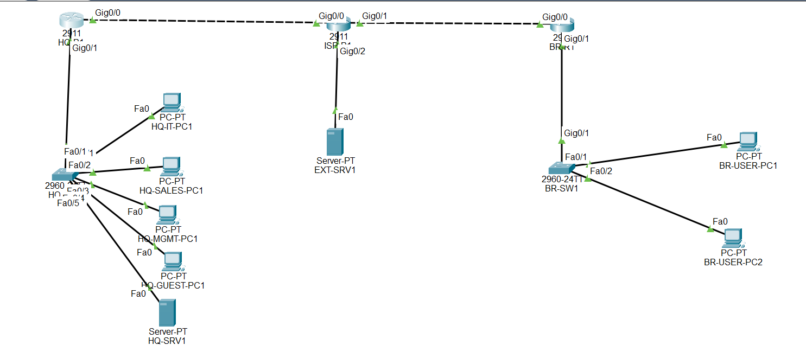
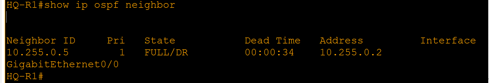
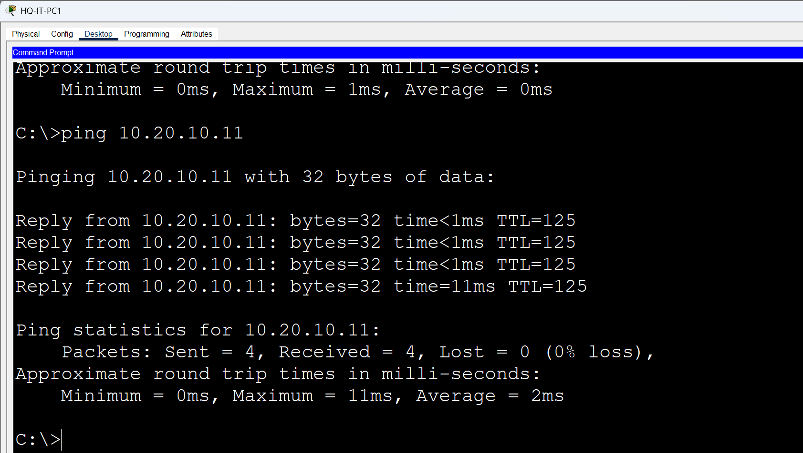
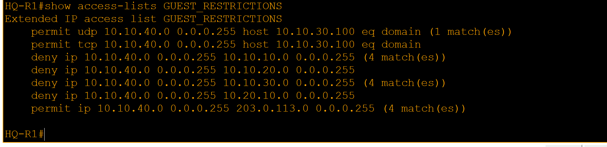
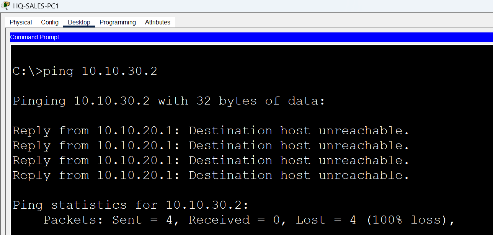
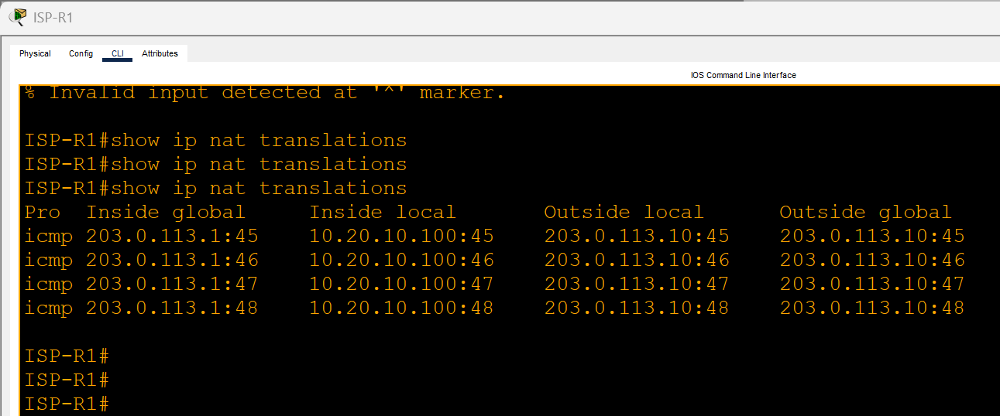
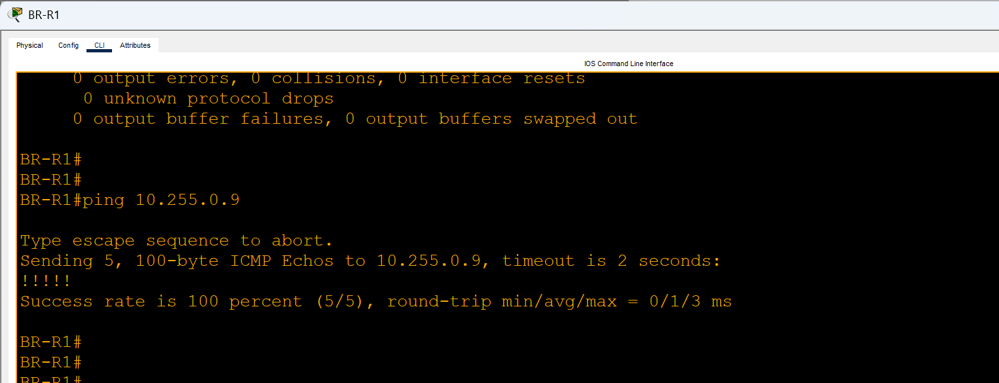

# Multi-Site Enterprise Network | Cisco Packet Tracer

A hands-on enterprise networking lab connecting headquarters and a branch office, with segmented departments, dynamic routing, centralized network services, access controls, and documented troubleshooting.

> **Project type:** Cisco Packet Tracer simulation · **Focus:** Network design, configuration, verification, troubleshooting

## At a glance

- **2 enterprise sites:** Headquarters and Branch

- **4 HQ user VLANs:** IT, Sales, Management, and Guest

- **Routing:** OSPF across the routed topology

- **Core services:** Centralized DHCP and DNS

- **Security:** Extended ACLs, SSH management, switch port security, unused-port shutdown

- **Edge connectivity:** Simulated ISP network with NAT/PAT

- **Tunnel:** GRE endpoint connectivity tested; not IPsec-encrypted

## Network topology



**Figure 1. Packet Tracer topology showing headquarters, branch office, ISP, and the simulated external server.**

The lab models a headquarters site and a branch connected through a simulated ISP. HQ-R1 routes between the HQ VLANs using router subinterfaces. OSPF distributes routes across the routed topology. HQ-SRV1 provides DHCP and DNS, while ISP-R1 provides NAT/PAT toward the simulated external subnet.

## Table of Contents

- [Project Overview](#at-a-glance)
- [Network Topology](#network-topology)
- [Technical Highlights](#technical-highlights)
- [Implementation Phases](#project-implementation-phases)
- [IP Addressing](#key-design-and-addressing)
- [Verification Results](#verification-highlights)
- [Troubleshooting Highlights](#troubleshooting-highlights)
- [Evidence Gallery](#evidence-gallery)
- [Repository Structure](#repository-contents)
- [Tools and Technologies](#tools-and-technologies)
- [Known Limitations](#known-limitations)
- [Lessons Learned](#lessons-learned)
- [Next Improvements](#next-improvements)
- [Open the Project](#open-the-project)

## Business scenario

A growing organization needs to connect headquarters and a branch while separating departments, centrally managing IP addressing and name resolution, restricting Guest and Sales access to protected networks, and validating connectivity across sites. This lab models those requirements in a reproducible network simulation and records both successful tests and troubleshooting findings.

## Project Implementation Phases

The project was built and documented in stages, moving from network design and connectivity to routing, services, security, tunneling, and troubleshooting. The phase summaries below reflect the implementation and testing described in this README. Dedicated phase documents are included in `docs/` for Phases 4, 6, 7, 8, and 9.

| Phase | Focus | Summary |
|---|---|---|
| Phase 1 | Topology and addressing | Planned the headquarters and branch topology, network segments, and IP addressing. |
| Phase 2 | Switching and VLANs | Built the switching foundation, including VLAN segmentation and access-port assignments. |
| Phase 3 | Inter-VLAN connectivity | Configured HQ router subinterfaces and VLAN default gateways. |
| Phase 4 | Routing | Configured OSPF, inspected routing tables and neighbors, and removed redundant static routes that took precedence over OSPF routes. See [`docs/phase4-routing-troubleshooting.txt`](docs/phase4-routing-troubleshooting.txt). |
| Phase 5 | Network services | Configured centralized DHCP and DNS, including DHCP relay for remote subnets. |
| Phase 6 | Security and administration | Applied Guest and Sales ACLs, configured SSH administration, and verified switch port security. See [`docs/phase6-security-troubleshooting.txt`](docs/phase6-security-troubleshooting.txt). |
| Phase 7 | GRE tunnel | Configured and tested GRE tunnel endpoint connectivity. The tunnel is not IPsec-encrypted and does not carry LAN routes in this implementation. See [`docs/phase7-gre-tunnel.txt`](docs/phase7-gre-tunnel.txt). |
| Phase 8 | Comprehensive testing | Recorded connectivity, DHCP, DNS, routing, NAT/PAT, ACL, SSH, interface, relay, and GRE checks. See [`docs/phase8-testing-log.txt`](docs/phase8-testing-log.txt). |
| Phase 9 | Troubleshooting and recovery | Documented controlled fault-and-recovery exercises for addressing, DNS, Guest ACL DHCP, OSPF advertisement, NAT/PAT, and DHCP relay. Scenario 5 was intentionally omitted. See [`docs/phase9-troubleshooting-log.txt`](docs/phase9-troubleshooting-log.txt).

The phases describe the project workflow; the individual logs and screenshots provide the detailed evidence and recorded results. Phase 5 is summarized from the network-services implementation described in this README; a separate Phase 5 document is not currently listed in the repository.

## Key design and addressing

| Segment | VLAN / role | Subnet | Gateway |
|---|---|---|---|
| HQ IT | VLAN 10 | `10.10.10.0/24` | `10.10.10.1` |
| HQ Sales | VLAN 20 | `10.10.20.0/24` | `10.10.20.1` |
| HQ Management / Server | VLAN 30 | `10.10.30.0/24` | `10.10.30.1` |
| HQ Guest | VLAN 40 | `10.10.40.0/24` | `10.10.40.1` |
| Branch users | Branch LAN | `10.20.10.0/24` | `10.20.10.1` |
| HQ–ISP WAN | Point-to-point | `10.255.0.0/30` | HQ `10.255.0.1`, ISP `10.255.0.2` |
| ISP–Branch WAN | Point-to-point | `10.255.0.4/30` | ISP `10.255.0.5`, Branch `10.255.0.6` |
| GRE tunnel | Tunnel endpoints | `10.255.0.8/30` | HQ `10.255.0.9`, Branch `10.255.0.10` |
| Simulated external subnet | ISP-facing test network | `203.0.113.0/24` | ISP `203.0.113.1`; server `203.0.113.10` |
**Key services and management addresses**

- HQ-SRV1: `10.10.30.100`

- HQ-SW1 management: `10.10.30.2`

- BR-SW1 management: `10.20.10.2`

- DNS record: `hq-srv1.enterprise.local` → `10.10.30.100`

Detailed addressing is documented in [`addressing/ip-addressing-plan.txt`](addressing/ip-addressing-plan.txt).

## Technical Highlights

### Switching and segmentation

- Created HQ VLANs 10, 20, 30, and 40 and assigned access ports.

- Configured the HQ switch trunk for the required VLANs.

- Assigned unused switch ports to VLAN 999 and shut them down.

- Configured sticky-MAC port security on active access ports.

### Routing and services

- Configured OSPF process 1, area 0, and verified neighbor state and learned routes.

- Configured router subinterfaces for HQ VLAN gateways.

- Configured centralized DHCP scopes and DHCP relay to HQ-SRV1.

- Configured DNS resolution for `hq-srv1.enterprise.local`.

- Configured NAT/PAT on ISP-R1 for tests to the simulated external subnet.

### Security and management

- Applied Guest and Sales ACLs to enforce the documented access restrictions.

- Configured SSH version 2 for router and switch management.

- Verified port security and shutdown of unused switch ports.

### GRE

- Configured a GRE tunnel between HQ-R1 (`10.255.0.9`) and BR-R1 (`10.255.0.10`).

- Verified tunnel status and endpoint reachability.

- The tunnel is **not IPsec-encrypted** and is **not used to carry the LAN routes** in this implementation.

## Verification highlights

The project includes test records for the following:

| Area | Verification | Result recorded |
|---|---|---|
| Branch-to-HQ connectivity | Ping between branch and HQ endpoints | Successful after route restoration |
| OSPF | `show ip route ospf`, `show ip ospf neighbor` | Expected routes and FULL neighbor state observed |
| DHCP | Client DHCP requests at HQ and Branch | Successful address assignment observed after recovery |
| DNS | `nslookup hq-srv1.enterprise.local` | Resolved to `10.10.30.100` with correct DNS configuration |
| ACLs | Guest DHCP and protected-network access checks | DHCP failure/recovery reproduced; restrictions tested |
| NAT/PAT | Ping to `203.0.113.10` and `show ip nat translations` | Translations observed when PAT was active |
| SSH | Remote device management | SSH access tested |
| GRE | Tunnel status and endpoint ping | Tunnel up/up and reachability verified |
See [`docs/phase8-testing-log.txt`](docs/phase8-testing-log.txt) for the detailed verification log.

## Troubleshooting highlights

I reproduced faults, observed symptoms, restored configuration, and verified recovery for these scenarios:

- **Stale IP:** Identified that the destination was using a different current DHCP address.

- **Incorrect DNS server:** Name lookup failed with the wrong DNS address while direct IP connectivity remained available; DNS recovered after returning the client to DHCP.

- **Guest DHCP blocked by ACL:** Removing the DHCP permit caused DHCP failure; restoring the permit restored address assignment.

- **Missing OSPF advertisement:** Removing the Branch LAN network statement removed the HQ route; restoring it brought the route and connectivity back.

- **Missing DHCP relay:** Removing `ip helper-address` caused the branch DHCP request to fail; restoring it recovered DHCP.

- **NAT/PAT controlled test:** The PAT rule was removed and the translation table was empty when checked, but the external ping still succeeded. The reason was not established, so this is recorded as an inconclusive outage test rather than a demonstrated connectivity failure.

The complete troubleshooting record is in [`docs/phase9-troubleshooting-log.txt`](docs/phase9-troubleshooting-log.txt). Scenario 5 was intentionally excluded.

## Evidence Gallery

The screenshots below highlight selected results from the project. The full evidence set is available in the [`screenshots/`](screenshots/) directory.

### Routing and connectivity





### Security policy verification





### NAT/PAT and tunneling





### Troubleshooting evidence

The Phase 9 screenshots document controlled faults and recovery. In Scenario 7, removing the PAT rule did not interrupt the observed external ping, so the outage test is documented as inconclusive rather than as a demonstrated failure.

| Evidence | What it demonstrates |
|---|---|
| [PAT baseline](screenshots/phase9_scenario7_pat_baseline.png) | Baseline PAT configuration |
| [External ping baseline](screenshots/phase9_scenario7_pat_connectivity_baseline.png) | External ping before the controlled change |
| [PAT translations baseline](screenshots/phase9_scenario7_pat_translations_baseline.png) | NAT translations after generating traffic |
| [PAT rule removed](screenshots/phase9_scenario7_pat_fault_config.png) | PAT rule temporarily removed |
| [Translation table during test](screenshots/phase9_scenario7_pat_translations_fault.png) | Translation table was empty when checked |
| [PAT rule restored](screenshots/phase9_scenario7_pat_recovery_config.png) | PAT rule restored |
| [PAT translations after recovery](screenshots/phase9_scenario7_pat_translations_recovery.png) | Translations observed after recovery traffic |
## Repository contents

```text
multi-site-enterprise-network/
├── README.md
├── topology/
│   └── multi-site-enterprise-network.pkt
├── configs/
│   ├── HQ-R1.txt
│   ├── ISP-R1.txt
│   ├── BR-R1.txt
│   ├── HQ-SW1.txt
│   └── BR-SW1.txt
├── addressing/
│   └── ip-addressing-plan.txt
├── diagrams/
│   └── multi_site_enterprise_topology.svg
├── screenshots/
└── docs/
    ├── phase4-routing-troubleshooting.txt
    ├── phase6-security-troubleshooting.txt
    ├── phase7-gre-tunnel.txt
    ├── phase8-testing-log.txt
    └── phase9-troubleshooting-log.txt
```

This tree matches the folder and file names in the reviewed project archive.

## Tools and Technologies

**Software and platform**
- Cisco Packet Tracer
- Cisco IOS-style command-line interface (CLI)

**Networking technologies**
- VLANs and IEEE 802.1Q trunking
- Router-on-a-stick and inter-VLAN routing
- OSPF dynamic routing
- DHCP, DHCP relay, and DNS
- NAT/PAT
- Extended access control lists (ACLs)
- SSH version 2 and switch port security
- GRE tunneling

**Troubleshooting and verification commands**
- `show ip route`
- `show ip ospf neighbor`
- `show ip nat translations`
- `ping`
- `traceroute` / `tracert`
- `ipconfig /all`
- `nslookup`

## Known limitations

- This is a simulation, not a production deployment.

- `203.0.113.10` is a simulated external server, not a real Internet host.

- GRE is not IPsec-encrypted and does not carry LAN routes in this implementation.

- During the controlled NAT/PAT test, the external ping remained successful while the PAT rule was absent. The reason was not established.

- Packet Tracer behavior and supported commands may differ from physical Cisco equipment and IOS versions.

## Lessons learned

- Check a destination's current IP before troubleshooting routing.

- Test DNS separately from direct IP connectivity.

- Verify both OSPF neighbor state and route advertisements.

- ACL order and DHCP permits matter when DHCP crosses a routed interface.

- A remote DHCP server requires correct relay configuration on the client-facing router interface.

- Record what a fault test actually shows instead of assuming the expected failure occurred.

- Restore temporary changes and verify recovery.

## Next Improvements

- Design an encrypted site-to-site VPN with IPsec on a platform that supports it.
- Consider routing selected site-to-site traffic through the GRE tunnel if required.
- Expand network monitoring, logging, and the formal test matrix.
- Consider adding further failure scenarios and documenting their verified recovery results.

These are potential future enhancements, not claims that they have already been implemented.

## Open the project

1. Install Cisco Packet Tracer.

2. Clone or download this repository.

3. Open `topology/multi-site-enterprise-network.pkt` in Packet Tracer.

4. Review the addressing plan, test log, troubleshooting log, and screenshots.

**---**

**Portfolio project demonstrating network design, configuration, verification, and troubleshooting in a simulated enterprise environment.**
